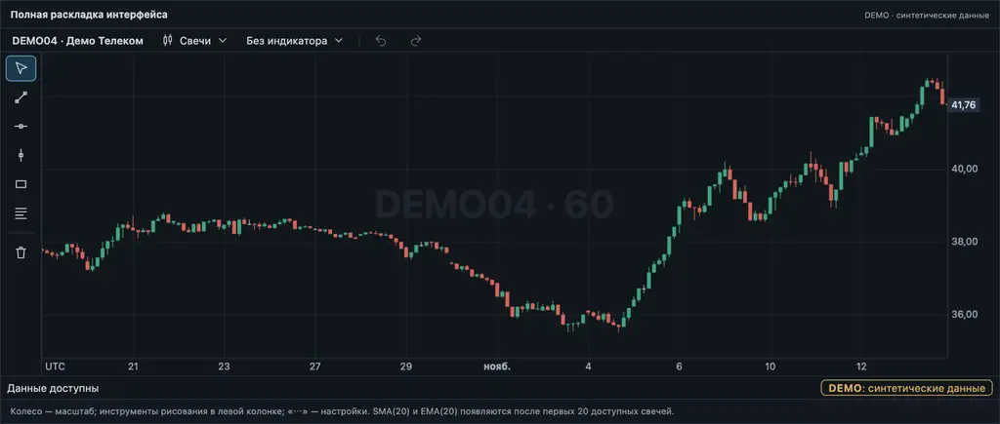
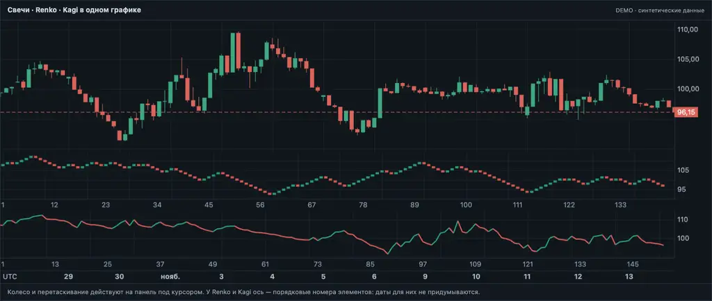

# VibeCharts

**English** | [Русский](README.ru.md)

Zero-dependency Canvas 2D charting library for market data: candlesticks, OHLC bars, lines, areas, histograms, baseline, derived views (Heikin Ashi, Renko, Kagi, Point & Figure), drawing tools, indicators, alerts and an accessible, composable UI.



Candles, Renko and Kagi in one chart: every pane has its own X axis.



The key idea is the **index axis**: data is attached to opaque slot identifiers (`barId`), not to timestamps. Time is optional; when present, the axis can align to calendar boundaries. The host owns the order; the library never sorts or invents anything.

> The demo UI text is in Russian. All data in the examples is synthetic.

## Install

The package is not published to npm yet. Install it from GitHub:

```sh
npm install github:Netizen231555/VibeCharts
```

Or locally from the package directory: `npm install ../VibeCharts`.

## Quick start

```js
import { createChart, attachChartFeatures, createChartUI } from 'vibecharts';
import 'vibecharts/styles.css';   // optional: styles for the package DOM
import 'vibecharts/ui.css';       // optional: UI layout and tokens

// host is an element that contains the chart container (the container is not moved)
const host = document.querySelector('#chart-host');
host.style.height = '480px';
const container = document.createElement('div');
container.style.height = '100%';
host.append(container);

const chart = createChart(container, { theme: 'dark', locale: 'en-US' });
attachChartFeatures(chart, {
  context: { instrumentId: 'DEMO', interval: '1d', sourceId: 'synthetic' },
  interaction: {},
});

// the timeline is an ordered list of host slots; time is optional
chart.timeline.setTimeline([
  { barId: 'b1', time: Date.UTC(2026, 0, 5) },
  { barId: 'b2', time: Date.UTC(2026, 0, 6) },
]);

const candles = chart.addSeries('candlestick', { id: 'price' });
candles.setData(
  [
    { barId: 'b1', open: 10, high: 12, low: 9, close: 11 },
    { barId: 'b2', open: 11, high: 13, low: 10, close: 12 },
  ],
  // metadata makes values meaningful: instrument, interval, source, price step
  { instrumentId: 'DEMO', interval: '1d', sourceId: 'synthetic', priceStep: 0.01 },
);

const ui = createChartUI(chart, { host, interaction: chart.interaction, demo: true });
```

## More API

```js
// continues the quick start; attachChartFeatures adds indicators and drawings
const heikin = chart.addDerivedView('heikinAshi', candles, { parameters: {} });

// an indicator in its own pane
const rsiPane = chart.addPane({ height: 0.3 });
chart.addIndicator({ type: 'rsi', source: candles.id, pane: rsiPane, parameters: { period: 14, sourceField: 'close' } });

// volume over the main pane without a second axis
const volume = chart.addSeries('histogram', { priceScaleId: 'volume' });
chart.priceScale('main', 'volume').setOverlay(true);

// volume delta (buyVolume - sellVolume; candle points carry buyVolume/sellVolume), coloured by sign
chart.addIndicator({ type: 'delta', source: candles.id, pane: rsiPane, style: { upColor: '#2fa77a', downColor: '#e0615a' } });

// calendar-aligned time ticks and a watermark
chart.applyOptions({ timeScale: { tickMode: 'time' } });
chart.applyOptions({ watermark: { text: 'DEMO', fontSize: 64 } });

// a drawing
chart.drawings.add({
  id: 'level',
  type: 'horizontalLevel',
  paneId: 'main',
  scaleId: 'right',
  anchors: [{ price: 12 }],
});
```

Keyboard: `Home` auto-scales the price axis, `F` toggles following the latest bar, `R` fits all data, `L` switches the price scale between linear and logarithmic. Every binding can be changed through the `bindings` option. While drawing or dragging a point, `Shift` keeps the second point at the first point's price (segment, ray, line, arrow, measure), and holding `Alt` snaps to the open/high/low/close of the first visible candle series and to the bar centre (`interaction.setDrawingSnap({ modifier })`).

The UI is built from parts (`topBar`, `drawingRail`, `navCluster`, `settingsMenu`, `statusLine`, `dataTable`) placed in regions (`top`, `start`, `overlay`, `bottom`, `menu`) through a validated `layout`; you can replace any part or remove actions with `layout.without`. See [examples/layouts/](examples/layouts/).

Full reference: [docs/contract.md](docs/contract.md) (in English). The Russian README has more detail on the UI parts and keys.

## Principles

- **No invented data.** A missing value is shown explicitly and never replaced by zero; loading, empty, available and error are different states.
- **The host owns order and identity.** `barId` is opaque and stable; time never defines order.
- **Accessible by default.** Semantic HTML, roles and keyboard operation; the interface is useful without styles.
- **Zero dependencies, zero network.** Canvas 2D and the DOM only.

## Examples

The [examples/](examples/) folder has runnable pages (see [examples/README.md](examples/README.md)):

```sh
node examples/terminal/serve.mjs 8340
# http://127.0.0.1:8340/examples/terminal/
# http://127.0.0.1:8340/examples/showcase/
# http://127.0.0.1:8340/examples/layouts/
```

All example data is synthetic and marked as a demonstration.

## Status

Version 0.1.0, before the first release: the API may change incompatibly in minor versions. Most of the code was written with AI assistance and checked by the author in a browser; there is no automated test suite yet. Do not use it for trading decisions without your own verification. Changes: [CHANGELOG.md](CHANGELOG.md).

Licensed under Apache-2.0, see [LICENSE](LICENSE). The software is provided "as is", without warranty. The examples use synthetic data and are not investment advice.
