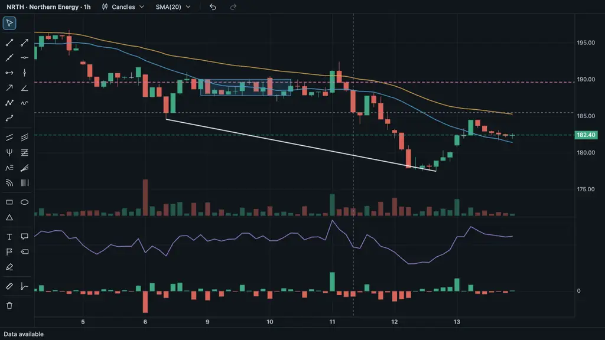

# VibeCharts

[English](README.md) | **Русский**

Библиотека графиков на Canvas 2D без зависимостей для рыночных данных: свечи, бары, линии, области и гистограммы, индикаторы, инструменты рисования, алерты и доступный интерфейс из настраиваемых частей.



## Возможности

- **Графики:** свечи, OHLC-бары, линии, области, гистограммы, базовая линия; несколько панелей с независимыми ценовыми шкалами; линейная, логарифмическая и процентная шкалы.
- **Индикаторы:** SMA, EMA, RSI, MACD, полосы Боллинджера, ATR, стохастик, VWAP, объём и дельта объёма; можно зарегистрировать свои.
- **Инструменты рисования:** 29 инструментов в левой панели по группам: линии, лучи, каналы, инструменты Фибоначчи, фигуры, текст, вилы и другие; привязка, отмена и повтор.
- **Алерты:** алерты по уровню цены, которые можно перетаскивать по графику.
- **Интерфейс:** перекрестие, легенда, контекстное меню, управление с клавиатуры, тёмная и светлая темы; свою раскладку можно собрать из частей.
- **Доступность по умолчанию:** семантический HTML, роли, работа с клавиатуры, таблица данных как альтернатива.
- **Индексная шкала:** данные привязаны к непрозрачным идентификаторам слотов (`barId`), а не к меткам времени, поэтому пропуски не искажают график. Время необязательно.
- **Ноль зависимостей, ноль сети:** только Canvas 2D и DOM.


## Установка

В npm пакет пока не опубликован. Установка из GitHub:

```sh
npm install github:Netizen231555/VibeCharts
```

## Быстрый старт

```js
import { createChart, attachChartFeatures, createChartUI } from 'vibecharts';
import 'vibecharts/styles.css';
import 'vibecharts/ui.css';

const host = document.querySelector('#chart-host');
host.style.height = '480px';
const container = document.createElement('div');
container.style.height = '100%';
host.append(container);

const chart = createChart(container, { theme: 'dark', locale: 'ru-RU' });
attachChartFeatures(chart, {
  context: { instrumentId: 'XYZ', interval: '1d', sourceId: 'my-feed' },
  interaction: {},
});

// Шкала — упорядоченные слоты хоста; время необязательно.
chart.timeline.setTimeline([
  { barId: 'b1', time: Date.UTC(2026, 0, 5) },
  { barId: 'b2', time: Date.UTC(2026, 0, 6) },
]);

const candles = chart.addSeries('candlestick', { id: 'price' });
candles.setData(
  [
    { barId: 'b1', open: 10, high: 12, low: 9, close: 11 },
    { barId: 'b2', open: 11, high: 13, low: 10, close: 12 },
  ],
  { instrumentId: 'XYZ', interval: '1d', sourceId: 'my-feed', priceStep: 0.01 },
);

chart.addIndicator({ type: 'sma', source: candles.id, pane: 'main', parameters: { period: 20, sourceField: 'close' } });

createChartUI(chart, { host, interaction: chart.interaction });
```

Язык интерфейса задаёт опция `locale` (`ru-*` или `en-*`). Клавиши: `Home` — автомасштаб, `F` — следование за последним баром, `R` — показать все данные, `L` — линейная/логарифмическая шкала; привязки настраиваются. Удержание `Alt` при рисовании включает привязку к O/H/L/C и центрам баров.

## Документация и примеры

- [docs/contract.md](docs/contract.md) — полный справочник (на английском).
- [examples/](examples/) — запускаемые страницы, см. [examples/README.md](examples/README.md):

```sh
node examples/terminal/serve.mjs 8340
# http://127.0.0.1:8340/examples/terminal/
```

Данные в примерах синтетические.

## Статус

Версия 0.1.0: проект vibe-coded — большая часть кода написана с помощью ИИ и проверялась автором в браузере. API может меняться несовместимо в минорных версиях; автоматических тестов пока нет. Не используйте для торговых решений без собственной проверки. Изменения — [CHANGELOG.md](CHANGELOG.md).

Лицензия — Apache-2.0, см. [LICENSE](LICENSE). «Как есть», без гарантий; не инвестиционная рекомендация.
